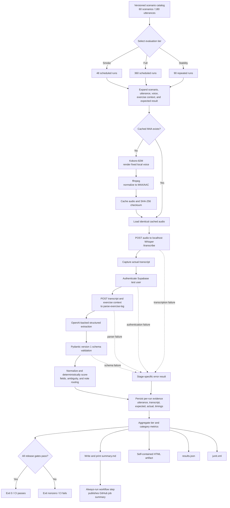

# Audio-to-structure evaluation pipeline PRD

**Status:** MVP implemented; initial smoke baseline recorded and currently below release thresholds

**Last updated:** November 17, 2026

**Owner:** MotionLog

## Summary

MotionLog converts a retained exercise voice note into a transcript, sends the transcript and exercise context to the `parse-exercise-log` Supabase Edge Function, and uses the response to prefill an editable exercise-log form. The MVP needs a repeatable evaluation pipeline that can detect regressions without requiring a person to record every utterance manually.

The pipeline generates and caches synthetic audio fixtures from labeled exercise-log scenarios, runs those fixtures through MotionLog's simulator Whisper transcription path and remote structured-data parser, and scores the resulting fields against ground truth. It provides a fast smoke suite for pull requests, a full semantic-coverage suite, and a repeated-run stability suite.

## Problem

Manual voice testing is slow, inconsistent, and too narrow to establish whether a prompt, model, parser, transcription component, or application change improved the system. A successful transcription also does not prove that the correct form fields were populated. MotionLog needs automated evidence for the complete path:

```text
ground-truth exercise log
→ generated utterance
→ synthetic audio
→ MotionLog transcription
→ structured extraction
→ normalized result
→ field-level score
```

The evaluation must make failures attributable. Every result must retain the intended utterance, actual transcript, expected structure, actual structure, and field-level differences.

## Goals

- Exercise the actual audio-to-structure path used by the iOS Simulator.
- Cover the ways users naturally report sets, repetitions, duration, resistance, weight, pain, each-side status, and notes.
- Test corrections, fillers, reordered information, implicit language, missing data, and ambiguous data.
- Detect unsupported or invented values, especially numeric and pain values.
- Make every run reproducible from versioned scenarios and cached audio.
- Produce machine-readable results plus a concise human-readable report.
- Support a small pull-request gate and more comprehensive pre-release gates.
- Preserve enough intermediate evidence to add transcription and acoustic metrics later without redesigning the fixture format.

## Non-goals for MVP

- Background-noise, reverb, clipping, pitch, or speed augmentation.
- Word error rate or character error rate scoring.
- Full-duplex conversation, interruption, barge-in, or turn-taking evaluation.
- Text-to-speech quality evaluation.
- Evaluation of Apple Speech on a physical iPhone in CI.
- Training or fine-tuning a transcription or language model.
- Using real patient recordings or protected health information.
- Automatically saving generated logs to Supabase tables. The parser is evaluated without persisting an exercise log.

## Current production boundary

The MVP system under test has two stages:

1. The simulator sends an audio file to the local-only Whisper endpoint at `POST http://127.0.0.1:55330/transcribe`.
2. The authenticated client sends the transcript and exercise context to `POST /functions/v1/parse-exercise-log`.

The expected parser response is version 1 and contains these nullable fields:

- `sets_completed`
- `reps_per_set`
- `duration_seconds`
- `band_resistance`
- `weight_value`
- `weight_unit`
- `pain_after`
- `each_side`
- `notes`

Prescription targets are context, not evidence of completed work. An omitted or ambiguous value must remain `null` rather than being copied from the prescription or guessed.

## Users of the evaluation

- Engineers changing the parsing prompt, model, schema, or Edge Function.
- Engineers changing transcription or audio-handling code.
- Agents implementing and verifying MotionLog changes.
- Product owners deciding whether extraction quality is sufficient to release.

## Dataset design

### Canonical semantic scenarios

The MVP dataset contains 60 versioned semantic scenarios:

| Category | Scenarios | Primary risks |
|---|---:|---|
| Straightforward sets, repetitions, and resistance | 20 | Basic extraction, units, band versus weight |
| Conversational speech and fillers | 10 | Filler leakage, notes pollution, unusual ordering |
| Corrections and ambiguity | 10 | Using the final correction, leaving uncertain fields blank |
| Pain and symptom descriptions | 10 | Pain assignment, pain timing, symptoms retained as notes |
| Timed exercises | 5 | Duration normalization, avoiding invented repetitions |
| Irrelevant, malformed, or adversarial input | 5 | Focus, schema validity, unsupported values |
| **Total** | **60** | |

Scenarios must include repetition-based and time-based exercises. They must cover pounds, kilograms, bands, bodyweight/no resistance, zero pain, nonzero pain, each-side language, useful symptom notes, and no-note cases.

### Utterance variants

Each semantic scenario has three fact-preserving utterance variants:

1. **Direct:** explicit, concise, and conventionally ordered.
2. **Natural:** conversational, possibly filler-heavy, and reordered.
3. **Difficult:** corrected, implicit, or intentionally ambiguous as appropriate to the scenario.

Ground truth is authored before utterances. MVP variants are produced from deterministic, versioned templates so fixture authoring has no model-API cost. A model may assist a deliberate future dataset-expansion pass, but it may not create the expected result. Every new utterance is reviewed once, committed as a fixture, and never regenerated during an evaluation run.

### Voices

Each utterance is rendered locally with two materially different Kokoro English voices. The initial pair contains one voice labeled male and one labeled female in Kokoro's voice catalog; these labels describe the synthetic voices and are not evidence of demographic coverage. Voice identifiers, Kokoro version, model revision, and generation settings are recorded in fixture metadata. Audio is generated ahead of time and cached so the same bytes are used across regression runs.

Synthetic voices improve coverage and repeatability but do not represent the full diversity of real speakers. Passing this evaluation establishes regression confidence, not population-level clinical validation.

### Full fixture count

```text
60 scenarios × 3 utterance variants × 2 voices = 360 unique audio fixtures
```

## Fixture format

Scenario definitions and their three fixed utterances are versioned in `evals/audio_to_structure/motionlog_eval/catalog.py`. The tier and voice expansion is defined in `fixtures.py`. Generated audio is stored in the ignored `.cache/audio` directory under a stable fixture identity containing the utterance, voice, Kokoro package/model metadata, format, and sample rate. GitHub Actions caches these files between runs.

Example:

```json
{
  "id": "pain-05-natural-af_heart",
  "scenario_id": "pain-05",
  "category": "pain_symptoms",
  "variant": "natural",
  "voice": "af_heart",
  "utterance": "Um, I got through three sets of ten, and afterward it was about a five.",
  "exercise": {
    "name": "Shoulder flexion wall slide",
    "tracking_mode": "reps"
  },
  "expected": {
    "sets_completed": 3,
    "reps_per_set": 10,
    "duration_seconds": null,
    "band_resistance": null,
    "weight_value": null,
    "weight_unit": null,
    "pain_after": 5,
    "each_side": null,
    "notes": []
  },
  "expect_notes": false,
  "required_note_facts": [],
  "forbidden_note_facts": [
    {
      "id": "pain_duplicated_in_notes",
      "patterns": ["pain.*five", "five.*pain"]
    }
  ],
  "ambiguous_fields": []
}
```

Notes are evaluated using expected presence plus versioned required and forbidden fact patterns rather than exact prose. A required fact contains a stable ID and a small set of accepted normalized phrases or regular expressions. This permits known harmless wording differences while ensuring that structured facts such as pain are not duplicated into notes. The MVP does not claim to solve general semantic equivalence between arbitrary note phrasings.

## Implemented MVP

### Components

- **Scenario catalog:** `catalog.py` contains 60 deterministic scenarios and 180 reviewed utterances. No hosted paraphrase model is required.
- **Fixture selection:** `fixtures.py` expands the catalog into the 48-run smoke, 360-run full, or 90-run stability tier.
- **Text-to-speech:** Local Kokoro-82M renders the pinned `af_heart` and `am_michael` English voices. After the initial model download, fixture generation requires no paid API.
- **Audio normalization:** `ffmpeg` produces M4A/AAC files accepted by the existing Whisper development server.
- **Runner:** `python -m motionlog_eval.runner --tier <tier>` orchestrates the end-to-end evaluation. `pytest` covers catalog integrity, tier composition, scoring, and report generation.
- **Schema validation:** Pydantic models match the version 1 parser contract.
- **Scoring:** A deterministic MotionLog-specific scorer computes per-run, category, scenario, and tier metrics.
- **Reports:** Every run produces console/Markdown, self-contained HTML, JSON, and JUnit XML reports.
- **Continuous integration:** `.github/workflows/audio-to-structure-eval.yml` runs unit tests and the smoke tier for relevant pull requests; all tiers are selectable with `workflow_dispatch`.

### Pipeline flow diagram



The runner must not silently use the local deterministic parser if the remote parser fails. A fallback would hide availability or model regressions. Failures must be recorded against the stage that produced them.

### Current baseline

The first local smoke run on November 16, 2026 completed all 48 audio-to-structure calls with schema-valid responses. It did not pass the release gates:

| Metric | Observed |
|---|---:|
| Pipeline completion | 100% (48/48) |
| Schema-valid responses | 100% |
| Slot F1 | 97.7% |
| Exact form match | 87.5% |
| Failed fixtures | 6 |

Four failures guessed a field for an ambiguous spoken “ten.” Two adversarial fixtures incorrectly populated pain as zero. These remain regression cases; the thresholds were not weakened to make the initial baseline pass.

### Documentation maintenance requirement

Any change to this evaluation pipeline must update this PRD in the same change. This includes changes to the scenario catalog, utterances, voices, TTS or transcription components, parser boundary, schema, metrics, thresholds, tier composition, reports, CI behavior, or dependencies. The Mermaid flow diagram must be reviewed and updated whenever the pipeline changes, and the PRD's `Last updated` date must reflect that review.

### Reproducibility

Every report must record:

- Git commit SHA.
- Scenario dataset version.
- Fixture ID and audio checksum.
- TTS provider, model, and voice used to create the fixture.
- Transcription implementation and model.
- Parser endpoint, prompt/schema version, and configured model when available.
- Attempt number.
- Start time and stage durations.
- Intended utterance and actual transcript.
- Expected and actual structured data.
- Field-level scoring and failure reason.

Random generation must use a recorded seed. Tests use committed fixtures by default.

## Evaluation metrics

### Pipeline completion rate

The percentage of scheduled runs that produce both a transcript response and a parser response within the per-run timeout. Transcription failures, authentication failures, parser failures, and timeouts are failures.

### Schema-valid response rate

The percentage of parser responses that decode as version 1 and satisfy type and range rules. Examples of invalid output include pain outside 0–10, nonpositive sets/repetitions/duration, a weight unit without a weight value, or a non-array `notes` value.

### Slot precision, recall, and F1

Slots are the eight nullable structured fields other than notes. Values are normalized before comparison: capitalization and surrounding whitespace for resistance, equivalent weight-unit spellings, and numeric representation differences do not count as errors.

- **Precision:** correctly populated slots divided by all populated slots.
- **Recall:** correctly populated slots divided by all expected populated slots.
- **F1:** harmonic mean of slot precision and recall.

A slot containing the wrong value is both a false positive and a false negative.

### Numeric field accuracy

Exact normalized accuracy across expected numeric opportunities for sets, repetitions, duration, weight value, and pain. This metric is reported overall and by field.

### Pain accuracy

Exact accuracy for `pain_after` across cases that contain an unambiguous post-exercise pain value. Pain mentioned in another temporal context must not be assigned to `pain_after` unless the labeled scenario expects it.

### False-fill rate

The number of expected-null slots incorrectly populated divided by all expected-null slot opportunities. This is the primary hallucination metric.

### Ambiguity blank rate

The percentage of fields labeled ambiguous that remain `null`. The system must prefer missing data over an unsupported guess.

### Note presence accuracy

The percentage of runs where notes are empty or nonempty as labeled by `expect_notes`. This catches both unnecessary notes and dropped note-worthy information without requiring arbitrary freeform strings to match.

### Required note-fact retention

The percentage of labeled required note facts matched by at least one accepted normalized phrase, alias, or regular expression. Because scenarios and outputs are controlled, each note-bearing scenario can define a small explicit matcher for facts such as shoulder clicking, discomfort location, or the final set.

### Structured-field leakage

The number of runs in which a fact that belongs in a structured field is instead included in notes. Pain, weight, resistance, duration, sets, and repetitions must be placed in their fields when unambiguous and must not be duplicated as note bullets.

### Forbidden note facts

The percentage of evaluated forbidden facts found in notes. Forbidden facts include filler, irrelevant conversation, corrected-away values, prescription targets presented as completed work, and other scenario-specific unsupported details.

MVP note matching is deliberately deterministic and set-specific. A general semantic model judge is deferred.

### Exact form match

A run passes exact form match when every structured slot is correct, all ambiguity requirements are respected, and the notes fact checks pass.

### Critical constraint violations

The following always fail a tier regardless of aggregate scores:

- An out-of-range pain value.
- A positive numeric value unsupported by the utterance.
- Copying a prescription target into a field without evidence that the user performed it.
- Filling a field explicitly labeled ambiguous.
- Moving a clearly structured pain, weight, resistance, duration, set, or repetition fact into notes instead of its field.
- Returning malformed data that the app cannot decode safely.

### Scenario robustness rate

For the full suite, a semantic scenario is robust when at least five of its six voice/utterance fixtures have an exact structured-slot match, the note-presence expectation and all required note facts are satisfied across at least five fixtures, and none of its fixtures has a critical constraint violation.

### Repeated-output consistency

For the stability suite, repeated-output consistency is the percentage of fixtures whose three normalized parser outputs are identical. Critical numeric fields and null-versus-populated decisions are also checked separately.

### Latency

The runner records transcription, parsing, and total latency. MVP latency is diagnostic because developer and CI hardware vary. Each stage retains its existing operational timeout, and any timeout reduces pipeline completion. A stable CI environment can add percentile release gates later.

## Testing tiers and pass thresholds

All thresholds are release gates unless marked diagnostic. A critical constraint violation fails any tier even when every aggregate threshold passes.

### Tier 1: Pull-request smoke suite

**Purpose:** Fast detection of obvious contract, prompt, authentication, and core-extraction regressions.

**Composition:** 12 fixed scenarios × 2 utterance variants × 2 voices = **48 runs**.

The 12 scenarios include four straightforward cases, two conversational cases, two correction/ambiguity cases, two pain/symptom cases, one timed case, and one irrelevant/malformed case.

| Metric | Required threshold |
|---|---:|
| Pipeline completion | 100% (48/48) |
| Schema-valid responses | 100% |
| Critical constraint violations | 0 |
| Slot F1 | ≥ 95% |
| Numeric field accuracy | 100% |
| Pain accuracy | 100% |
| False-fill rate | 0% |
| Ambiguity blank rate | 100% |
| Note presence accuracy | 100% |
| Required note-fact retention | ≥ 90% |
| Structured-field leakage | 0 cases |
| Forbidden note facts | 0 cases |
| Exact form match | ≥ 90% (at least 44/48) |

The smoke subset is intentionally stable and curated. A known flaky fixture must be repaired or removed with an explained dataset change; it must not be retried until it passes.

### Tier 2: Full baseline suite

**Purpose:** Measure broad semantic coverage before a release and detect category-specific regressions.

**Composition:** 60 scenarios × 3 utterance variants × 2 voices = **360 runs**.

| Metric | Required threshold |
|---|---:|
| Pipeline completion | ≥ 99% (at least 357/360) |
| Schema-valid responses among completed runs | ≥ 99.5% |
| Critical constraint violations | 0 |
| Slot F1 | ≥ 92% overall and ≥ 85% in every category |
| Numeric field accuracy | ≥ 95% overall and ≥ 90% for each numeric field |
| Pain accuracy | ≥ 95% |
| False-fill rate | ≤ 1% |
| Ambiguity blank rate | ≥ 98% |
| Note presence accuracy | ≥ 95% |
| Required note-fact retention | ≥ 90% |
| Structured-field leakage | 0 cases |
| Forbidden note-fact rate | ≤ 1% |
| Exact form match | ≥ 85% overall and ≥ 75% in every category |
| Scenario robustness rate | ≥ 90% (at least 54/60 scenarios) |

Aggregate success may not hide a weak category. Both the overall and per-category gates must pass.

### Tier 3: Stability suite

**Purpose:** Detect nondeterminism in the difficult cases most likely to change across repeated model calls.

**Composition:** 30 fixed difficult audio fixtures × 3 calls with identical input = **90 runs**.

The subset emphasizes corrections, implicit pain, multiple numbers, ambiguity, note classification, and irrelevant instructions. The same audio bytes and exercise context are reused for all three attempts.

| Metric | Required threshold |
|---|---:|
| Pipeline completion | 100% (90/90) |
| Schema-valid responses | 100% |
| Critical constraint violations | 0 |
| Slot F1 | ≥ 95% |
| Numeric field accuracy | ≥ 98% |
| Pain accuracy | 100% |
| False-fill rate | 0% |
| Ambiguity blank rate | 100% |
| Note presence accuracy | 100% |
| Required note-fact retention | ≥ 95% |
| Structured-field leakage | 0 cases |
| Forbidden note facts | 0 cases |
| Exact form match | ≥ 90% (at least 81/90) |
| Identical normalized output across all three attempts | ≥ 96.7% (at least 29/30 fixtures) |
| Identical critical numeric and null/populated decisions | 100% |

One inconsistent noncritical notes rendering may be tolerated. Any variation in a critical numeric value or whether an ambiguous field is populated fails the suite.

## When each tier runs

| Event | Required suites |
|---|---|
| Ordinary pull request | Smoke |
| Parser prompt, schema, or model change | Smoke, full baseline, stability |
| Transcription implementation or model change | Smoke, full baseline, stability |
| Fixture-generation or scoring change | Smoke and full baseline; stability if output comparison changes |
| Release candidate | All three |
| Scheduled monitoring | Full baseline, initially manual or nightly once cost is acceptable |

## Reports and failure output

The pipeline writes:

- `results.json`: complete run records and aggregate metrics.
- `summary.md`: tier status, release gates, and a concise failure table. The evaluator prints it in the action log, then a separate `always()` workflow step appends the completed file to the GitHub job summary. Keeping publication outside the evaluator ensures the summary is rendered even when the evaluator exits nonzero because a release gate failed.
- `report.html`: a self-contained, responsive report with expandable expected/actual values, utterances, transcripts, and failure details.
- `junit.xml`: CI-native per-fixture and tier-gate results.

GitHub Actions uploads all four files as one downloadable artifact, even when the evaluation exits nonzero. Audio remains in the workflow cache and is not included in the report artifact.

A failure should be immediately actionable. Example:

```text
FAIL pain-05-natural-af_heart
Stage: structured extraction
Expected: pain_after=5, notes=[]
Actual: pain_after=null, notes=["Pain was five after the exercise"]
Transcript: "pain was five after the exercise"
Failed gates: pain accuracy, exact form match, critical structured-fact placement
```

## CI and secrets

- Pull-request evaluation is configured to run in GitHub Actions against synthetic fixtures and a dedicated Supabase test user, not production user data.
- `SUPABASE_URL`, `SUPABASE_ANON_KEY`, `MOTIONLOG_TEST_PHONE`, and `MOTIONLOG_TEST_OTP` are GitHub Actions secrets. The OpenAI key remains only in the hosted Supabase Edge Function and is not exposed to CI.
- Secrets and generated access tokens must never appear in reports or fixtures.
- The parser call does not insert an `exercise_logs` or `audio_recordings` row.
- Synthetic fixtures must not include real patient names, phone numbers, medical records, or copied user recordings.
- Cached audio is treated as a build fixture and labeled as synthetic.

## Cost controls

- Generate and cache audio locally with pinned Kokoro-82M model and voice revisions; routine evals reuse it.
- Fixture authoring uses deterministic templates, so neither paraphrasing nor text-to-speech requires a paid API.
- The 48-run smoke suite is the default pull-request gate.
- The 360-run full baseline and 90-run stability suite run only for relevant changes, release candidates, or scheduled checks.
- The production OpenAI-backed structured parser remains the only paid step in the MVP evaluation. Token usage and estimated cost are not currently available to the runner because the Edge Function does not expose provider usage; adding safe aggregate usage metadata is future work.

## Statistical interpretation

The 360 full-suite runs provide useful regression evidence but are clustered within 60 semantic scenarios. They must not be described as 360 independent users. Reports show both run-level metrics and scenario robustness.

At an observed pass rate near 95%, 360 independent runs would imply an approximate 95% sampling margin of ±2–3 percentage points. Because fixtures share scenarios and synthetic voices, the true uncertainty is larger. The suite supports engineering release decisions; it is not evidence of accuracy across all speakers, accents, recording environments, injuries, or clinical language.

## MVP implementation status

Completed:

- All 60 canonical scenarios and 180 fact-preserving utterances are versioned.
- The runner supports smoke, full, and stability tiers and returns a nonzero status when a release gate fails.
- Kokoro rendering, M4A normalization, audio checksums, local Whisper transcription, Supabase test-user authentication, and the hosted parser path have been exercised locally.
- Expected and actual version 1 outputs are schema validated and normalized.
- The metrics and tier gates in this PRD are implemented.
- Markdown, self-contained HTML, JSON, and JUnit XML reports are produced.
- Failed runs retain enough evidence to distinguish audio, transcription, authentication, parser, schema, and scoring failures.
- The GitHub Actions workflow runs unit tests, selects all three tiers, publishes the Markdown job summary from a separate `always()` step, and uploads the report artifact even on failure.

Remaining before the evaluation system is fully operational:

- Verify the separate always-run summary publication step in a remote workflow run. The four required GitHub Actions secrets are configured, and the first remote smoke run completed all 48 cases and uploaded its artifact on November 16, 2026.
- Run and review the 360-case full tier and 90-call stability tier.
- Populate or cache all 360 audio fixtures; only the smoke fixtures have been generated so far.
- Record the parser prompt/schema version and configured model in report metadata.
- Check in or link dated full and stability baseline reports.

## Future extensions

- Add Audiomentations conditions such as gym noise, distance, clipping, reverb, and speed changes.
- Add JiWER transcription metrics and numeric/entity transcription accuracy.
- Add a small set of consented human recordings across speakers and devices.
- Add physical-device Apple Speech evaluation.
- Add semantic model judging for complex note facts, calibrated against human review.
- Add latency percentile gates after establishing stable CI hardware.
- Add production-failure sampling so corrected real-world failures become de-identified regression scenarios.
- Add model and prompt comparisons using the same immutable fixture set.
